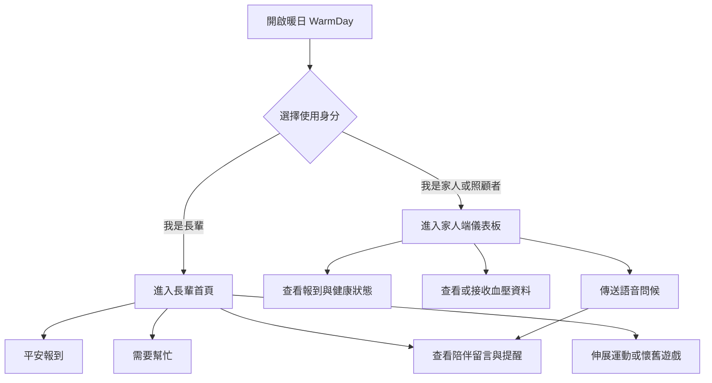
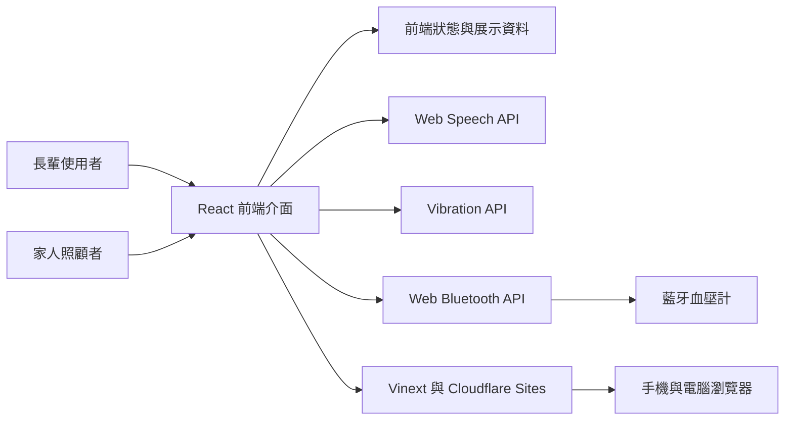

# 暖日 WarmDay 系統流程與架構說明

學生姓名：Sydney Huang  
學號：＿＿＿＿＿＿＿＿  
專題類型：銀髮健康促進與家庭陪伴 Web App  
線上展示：https://warmday-sydney.sydneyhuang614.chatgpt.site

## 1 專題摘要

暖日 WarmDay 是一款為長輩與家人照顧者設計的健康陪伴 Web App。專題的核心不是要求長輩完成更多任務，而是以大字體、大按鈕、低操作層級及溫柔語音，讓平安報到、健康提醒、簡易運動與家人關懷成為沒有壓力的日常。

目前版本為可操作的互動原型，提供長輩端及家人照顧者端。登入、血壓紀錄、提醒與留言資料主要用於功能展示；正式產品仍需串接帳號、後端資料庫、推播通知及實際藍牙血壓計。

## 2 老師檢視方式

本專題採展示模式，不需要另外建立帳號。

| 項目 | 檢視資訊 |
| --- | --- |
| 網站 | https://warmday-sydney.sydneyhuang614.chatgpt.site |
| 帳號 | 不需要 |
| 密碼 | 不需要 |
| 長輩端 | 開啟網站後選擇「我是長輩」 |
| 家人端 | 開啟網站後選擇「我是家人／照顧者」 |
| 建議裝置 | 電腦或手機瀏覽器；藍牙示範建議使用 Android Chrome |

建議老師先體驗長輩端的一鍵報平安、今日陪伴卡、伸展運動及「我看不懂」，再切換至家人端查看血壓紀錄與家人語音留言。

## 3 使用者角色

### 3.1 長輩

- 一鍵完成平安報到。
- 需要時快速選擇求助原因。
- 查看用藥、血壓及伸展提醒。
- 播放家人的陪伴留言及介面語音。
- 使用字體調整、中文或台語介面及簡化協助。
- 進行坐姿伸展、健康小知識與無競賽壓力的小遊戲。

### 3.2 家人或照顧者

- 查看長輩是否完成平安報到。
- 查看提醒進度、求助狀態及血壓紀錄。
- 嘗試連接支援標準 Bluetooth Blood Pressure Service 的血壓計。
- 傳送簡短問候，顯示在長輩端的今日陪伴卡。
- 只在未報到或主動求助時接收重要通知，避免過度監控。

## 4 操作流程

### 4.1 整體流程



### 4.2 長輩端流程

1. 開啟網站並選擇「我是長輩」。
2. 首頁顯示問候、今日陪伴卡及最重要的兩個操作。
3. 按下「我今天很好」即可完成平安報到。
4. 若需要協助，按下「我需要幫忙」並選擇身體不舒服、心情不太好或想找家人。
5. 若看不懂畫面，可按固定的「我看不懂」，系統會用更簡單的按鈕和語音再次說明。
6. 使用者可依需求查看提醒、完成伸展、聽笑話或玩懷舊配對遊戲。

### 4.3 家人端流程

1. 開啟網站並選擇「我是家人／照顧者」，或由長輩端切換至家人模式。
2. 儀表板顯示今日報到、提醒進度與最近血壓。
3. 可查看每次量測時間、收縮壓、舒張壓及脈搏。
4. 使用支援的瀏覽器時，可按「連接血壓計」搜尋標準藍牙血壓裝置。
5. 選擇一則溫柔問候並送出，長輩端的今日陪伴卡會更新內容。

### 4.4 運動完成流程

1. 在今日提醒中開啟「伸展運動」。
2. 選擇肩膀伸展、坐姿抬膝或腳踝繞圈。
3. 查看示意圖或播放語音說明。
4. 按下「開始 10 秒」。
5. 倒數完成後才列入完成進度；離開頁面時會自動暫停。
6. 最後三秒提供聲音與裝置震動提示，若不舒服可隨時停止。

## 5 系統架構

### 5.1 架構圖



### 5.2 系統分層

| 層級 | 使用技術 | 主要責任 |
| --- | --- | --- |
| 使用者介面層 | React 19、TypeScript、CSS | 顯示長輩端、家人端、彈出視窗與響應式版面 |
| 互動狀態層 | React State、Effects | 管理角色、報到狀態、運動倒數、留言、遊戲與血壓紀錄 |
| 裝置能力層 | Web Speech、Web Bluetooth、Vibration API | 語音朗讀、藍牙量測接收與震動提示 |
| 建置層 | Vinext、Vite | 將 React 專案編譯為可部署的網站 |
| 雲端層 | OpenAI Sites、Cloudflare Workers | 提供公開網址與跨裝置存取 |

### 5.3 主要元件

| 元件 | 功能 |
| --- | --- |
| 登入角色選擇 | 在展示模式中切換長輩及家人照顧者身分 |
| 長輩首頁 | 顯示問候、陪伴卡、報到、求助、提醒及活動入口 |
| 簡化協助 | 將操作縮減為「我今天很好」及「我需要幫忙」 |
| 運動教學 | 顯示動作圖解、步驟、倒數、語音及震動 |
| 懷舊遊戲 | 提供無分數、無時間限制的圖示配對 |
| 家人儀表板 | 顯示報到、提醒、血壓及關懷狀態 |
| 血壓連線 | 讀取標準藍牙血壓量測特徵值並加入紀錄 |
| 家人留言 | 將家人的問候更新至長輩端陪伴卡並朗讀 |

## 6 資料流程

### 6.1 平安報到

長輩按下「我今天很好」後，前端將畫面狀態更新為完成，顯示回報成功與每日笑話。現階段資料保留於展示介面；正式版本應將結果寫入資料庫並通知指定家人。

### 6.2 家人留言

家人端選擇留言後，內容會更新至共用的前端狀態。切回長輩端時，今日陪伴卡顯示最新留言，並可透過 Web Speech API 播放。

### 6.3 血壓量測

家人端要求瀏覽器搜尋支援標準血壓服務的藍牙裝置。連線成功後，系統監聽 blood pressure measurement 特徵值，解析收縮壓、舒張壓與脈搏，並將最新結果加入畫面紀錄。

## 7 長輩友善設計

- 使用大按鈕、大字體、高對比及清楚的操作文字。
- 首頁優先顯示最重要的平安報到與求助。
- 提供字體大小、中文、台語及語音朗讀功能。
- 不使用排行榜、連續打卡、扣分或責備式提醒。
- 「今天想休息」不會產生未完成壓力。
- 健康知識及遊戲採使用者主動開啟，不使用頻繁彈窗。
- 重要操作皆可取消、返回或重新播放說明。

## 8 技術與檔案結構

```text
warmday/
├─ app/
│  ├─ page.tsx          主要畫面、互動邏輯與藍牙流程
│  ├─ globals.css       全站樣式與手機響應式設計
│  └─ layout.tsx        網頁標題與說明
├─ public/              圖示與伸展運動示意圖
├─ worker/              Cloudflare Worker 入口
├─ tests/               畫面輸出測試
├─ vite.config.ts       Vinext 與 Sites 建置設定
├─ package.json         套件與執行指令
└─ README.md            專案簡介與開發方式
```

## 9 目前限制

- 帳號及身分選擇為展示模式，沒有正式驗證機制。
- 報到、留言、提醒及血壓紀錄尚未永久儲存。
- 家人留言目前以瀏覽器合成語音播放，尚未錄製真實家人聲音。
- Web Bluetooth 的支援依瀏覽器及裝置而異，iPhone Safari 支援有限。
- 部分血壓計採用原廠格式，需要額外 SDK 或 API。
- 本系統提供日常健康紀錄，不作為醫療診斷或緊急救援工具。

## 10 後續發展

1. 加入正式帳號、家人綁定與權限管理。
2. 建立後端資料庫，保存報到、留言、提醒及血壓歷史。
3. 串接推播通知，在未報到或主動求助時提醒家人。
4. 支援錄製家人真實語音及客語等更多語言。
5. 與實際血壓計進行相容性及使用者測試。
6. 進行長輩可用性測試，評估完成時間、誤觸率與使用意願。

## 11 驗收建議

| 測試情境 | 操作 | 預期結果 |
| --- | --- | --- |
| 平安報到 | 長輩端按「我今天很好」 | 顯示完成訊息並可返回首頁 |
| 主動求助 | 選擇「我需要幫忙」及原因 | 顯示已通知家人的關懷訊息 |
| 簡化協助 | 按「我看不懂」 | 顯示兩個大按鈕並播放語音 |
| 家人留言 | 家人端選擇並送出問候 | 長輩端陪伴卡更新內容 |
| 運動完成 | 完成 10 秒倒數 | 動作列入完成進度 |
| 響應式版面 | 使用手機開啟網站 | 內容改為單欄且按鈕可清楚點選 |

